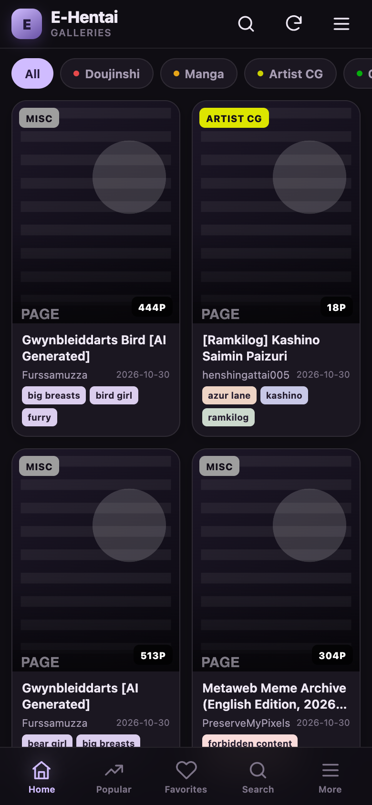
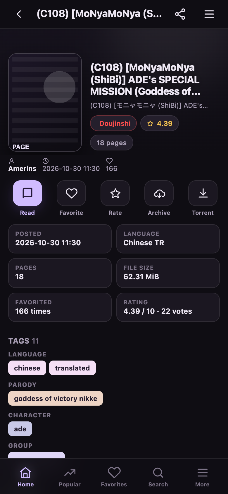
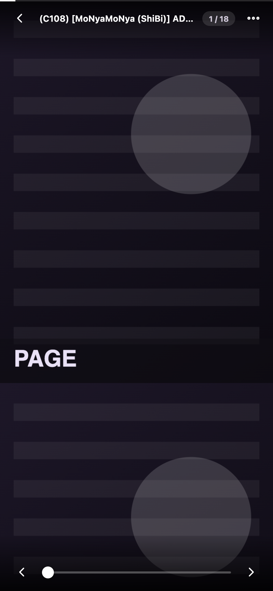

# E-Hentai App — a JHenTai-style mobile shell

A single-file userscript that turns **e-hentai.org** and **exhentai.org** into a fast,
app-like mobile experience. The layout, gallery cards, detail page and reader are
inspired by [JHenTai](https://github.com/jiangtian616/JHenTai), but everything here is
plain JavaScript running in your own browser.

> Not affiliated with E-Hentai, ExHentai, or JHenTai. It is a client-side skin: all
> requests go to the real site with your own session. It does not bypass age gates,
> GP costs, or site rules.

[](https://raw.githubusercontent.com/lenchan139/xHentai-js/v1.0.8/ehentai-app.user.js)
[](https://raw.githubusercontent.com/lenchan139/xHentai-js/v1.0.8/ehentai-app.user.js)
[](https://github.com/lenchan139/xHentai-js)

| Home | Detail | Reader |
| --- | --- | --- |
|  |  |  |

---

## Features

- **App shell** — sticky top bar, five-tab bottom navigation (Home, Popular,
  Favorites, Search, More), slide-out drawer, iPhone safe areas, dark/light themes.
- **Gallery lists** — 2/3-column cards or compact rows, category and tag colors,
  page count, uploader, read progress, infinite scroll, cover blur, favorites folder
  chips.
- **Gallery detail** — full-bleed cover, one-tap Read/Favorite/Rate/Archive/Torrent/
  Comments/Share, info grid, grouped tags, page-preview grid with jump-to-page.
  The cover and title appear immediately when you tap a card, even if the site is
  slow to send the rest.
- **Reader** — vertical continuous or paged horizontal, width/contain fit,
  1–4 pages of preload, tap zones, auto-hiding chrome, range slider, jump-to-page,
  retry, original page, and a **Resampled / Original** image-resolution switch.
- **Search** — E-Hentai syntax, all 10 categories, rating, page range, torrents,
  expunged, recent searches.
- **Library** — local reading history, resume positions, clear history/progress/
  cache.
- **Login** — password or cookie login. Favorites and ratings work in-app; other
  account actions open the original site.
- **No tracking** — no proxy, no analytics, no third-party server.

## Download

**Direct install snapshot — v1.0.8 (cache-free):**

<https://raw.githubusercontent.com/lenchan139/xHentai-js/v1.0.8/ehentai-app.user.js>

**Auto-update source — always `main`:**

<https://raw.githubusercontent.com/lenchan139/xHentai-js/main/ehentai-app.user.js>

- [Install v1.0.8](https://raw.githubusercontent.com/lenchan139/xHentai-js/v1.0.8/ehentai-app.user.js)
- [Open main raw](https://raw.githubusercontent.com/lenchan139/xHentai-js/main/ehentai-app.user.js)
- [GitHub repository](https://github.com/lenchan139/xHentai-js)
- [Built file in the repository](ehentai-app.user.js)

The script has no external dependencies and uses no `GM_*` APIs, so it works in every
mainstream userscript manager.

## Install

### iPhone / iPad (Safari)

**Option A — Tampermonkey (auto-updates)**

1. Install **Tampermonkey** from the App Store (paid on iOS/iPadOS).
2. Open **Settings → Safari → Extensions → Tampermonkey**, enable it, and allow it
   on `e-hentai.org` and `exhentai.org`. The **AA** menu → **Manage Extensions** also
   works.
3. Open the [v1.0.8 install link](https://raw.githubusercontent.com/lenchan139/xHentai-js/v1.0.8/ehentai-app.user.js)
   in Safari. If Safari shows the script as text instead, open the Tampermonkey app,
   tap **+**, paste the contents, and save.
4. Visit `https://e-hentai.org/` (and `https://exhentai.org/`).

**Option B — Userscripts (free, open source)**

1. Install **Userscripts** from the App Store.
2. Enable it in **Settings → Safari → Extensions → Userscripts** and allow it on both
   sites.
3. In the Userscripts app, choose a scripts directory in Files (iCloud Drive or
   On My iPhone), then save the [v1.0.8 userscript](https://raw.githubusercontent.com/lenchan139/xHentai-js/v1.0.8/ehentai-app.user.js)
   into it as `ehentai-app.user.js`.
4. Reload the site in Safari.

### macOS Safari / desktop browsers

- **Safari (macOS):** install Tampermonkey, enable it in Safari settings, add the
  script, and allow it for both domains.
- **Chrome / Edge / Firefox / Brave:** install Tampermonkey or Violentmonkey, create
  a new script, paste the file, save.

### Enable it on both domains

The script is matched separately for `e-hentai.org` and `exhentai.org`. Enabling it
for one does not enable it for the other.

## Updating

The header points at the `main` branch:

```js
// @downloadURL  https://raw.githubusercontent.com/lenchan139/xHentai-js/main/ehentai-app.user.js
// @updateURL    https://raw.githubusercontent.com/lenchan139/xHentai-js/main/ehentai-app.user.js
```

**Tampermonkey** checks that URL periodically and installs newer versions
automatically. To force a check: Tampermonkey → **Utilities → Check for userscript
updates**. The versioned install link above also updates from `main` after the first
install.

> **Userscripts (Safari iOS)** does not guarantee background update checks. Re-open
> the raw link or the app's reload action when a new version is announced.
> Tampermonkey is the auto-updating path.

## Logging in

Most of the app works as a guest. Favorites, watched tags and some galleries need a
session.

### E-Hentai

Drawer → **Log in**. Two methods:

- **Password:** posts to the E-Hentai forum login and returns. You briefly leave the
  app.
- **Cookie login (recommended on iPhone/iPad):** paste these three cookies from a
  browser where you are logged in:
  - `ipb_member_id`
  - `ipb_pass_hash`
  - `igneous`

  The app writes them for the current site with `path=/` and a one-year expiry. You
  can copy them on desktop with DevTools → **Application → Cookies → e-hentai.org**,
  or with a cookie-editor extension.

### ExHentai

ExHentai needs the same cookies set for **`exhentai.org`**:

- Log in on `e-hentai.org` first, then open `exhentai.org`.
- If you still get the sad panda, use a cookie editor to set `ipb_member_id`,
  `ipb_pass_hash` and `igneous` for `exhentai.org`, then reload.
- The in-app Cookie login writes cookies for the domain it is running on. It cannot
  write `exhentai.org` cookies while running on `e-hentai.org` (browser security),
  so do it on the ExHentai side or use a cookie editor.

The username/password form logs into the forum and may not be enough for ExHentai;
the cookie method is the reliable one.

## Using it

### Navigation

- **Home:** recent galleries, category chips, grid/list toggle.
- **Popular / Favorites / Search:** bottom tabs.
- **More:** Front Page, Popular, Favorites, Watched, Toplists, History, Settings,
  Login, Theme, Open original site.
- Tap a card for the detail page; tap **Read** to enter the reader.
- Browser back (including the iOS edge-swipe) returns to the previous app page.

### Reader gestures

- Tap the **center** to show/hide the chrome.
- Tap the **left/right third** to go to the previous/next page.
- Vertical mode: scroll continuously. Paged mode: swipe horizontally; pages snap.
- Use the range slider or the counter pill for fast navigation.
- Menu: reading mode, image fit, image resolution, jump, reload, open image,
  gallery, original page, share.

### Image resolution

The reader uses E-Hentai's **resampled** WebP by default (usually 1280 px, about
100–300 KB). To read the original files, open the reader menu → **Image resolution** →
**Original**, or set it globally under **Settings → Reader → Image resolution**.
Originals can be several MB; if one fails, only that page falls back to resampled.

### Search tips

- `language:chinese`, `language:translated`
- `artist:shibi`, `group:monyamonya`, `parody:blue archive`
- `f:sole female`, `m:sole male`
- Combine with free text; quote multi-word tags if needed.

### Escape hatch

Add `?ehx=off` to any URL to render the original site instead of the app, e.g.
`https://e-hentai.org/g/1234567/abcdef1234/?ehx=off`. The drawer's **Open original
site** does this for you.

## What is taken over (and what is not)

| Page | Behaviour |
| --- | --- |
| `/`, `/doujinshi`, `/manga`, `/artistcg`, `/gamecg`, `/western`, `/non-h`, `/imageset`, `/cosplay`, `/asianporn`, `/misc` | In-app list |
| `/tag/*`, `/uploader/*` | In-app list |
| `/popular`, `/watched`, `/favorites.php` | In-app list (login card when required) |
| `/toplist.php` | In-app rank list |
| `/g/<gid>/<token>/` | In-app detail |
| `/s/<key>/<gid>-<n>` | In-app reader |
| `/home.php`, `/archiver.php`, `/gallerytorrents.php`, `/torrents.php`, `/news.php`, `/bounty.php` | Original site |
| Forums, wiki, HentaiVerse, uploads | Original site |

Tag editing, comment posting, archive downloads and torrents stay on the original
site. Favorites and ratings are the two account actions implemented in-app.

## Privacy and security

- No third-party server, proxy, analytics or telemetry.
- Gallery/list/reader requests are plain `fetch` calls to the **current origin**, so
  they use your existing cookies.
- The only cross-origin request is the rating call to `https://api.e-hentai.org/api.php`;
  it is sent without credentials and uses the API key the gallery page itself embeds.
  The optional password login is a normal form POST to the E-Hentai forum.
- Settings, reading progress, history and recent searches live in `localStorage`.
  Cookies stay in Safari's normal cookie store.
- Remove everything by deleting the script and clearing website data for the domain.
- Comments are sanitized before rendering (scripts, event handlers and non-HTTP URLs
  are stripped).

## Troubleshooting

**Blank or unstyled page**
- Confirm the URL is one of the supported routes above.
- Reload once. Check that the extension is enabled for the exact domain (`www.`
  included) and that no other e-hentai userscript conflicts.
- Open `…?ehx=off` to use the original page.

**"This page requires you to log on"**
- Drawer → Log in. On iPhone, cookie login is the most reliable.

**Sad panda / white screen on ExHentai**
- Set the three cookies for `exhentai.org` (see above), or log in on E-Hentai first
  and reload ExHentai.
- Remove stale ExHentai site data: **Safari → Settings → Privacy → Manage Website
  Data → `exhentai.org` → Remove**, then open `https://e-hentai.org/home.php`, log in,
  and open ExHentai. This also removes the problematic `yay` cookie.
- The authenticating cookies are `igneous`, `ipb_member_id`, and `ipb_pass_hash`;
  `yay` alone is not enough.

**"E-Hentai is rate-limiting requests" (HTTP 509)**
- Wait a minute; lower **Preload pages** in Settings; avoid opening many galleries at
  once.

**Images fail to load**
- A failed cover falls back to a neutral placeholder instead of a broken image.
- Tap **Retry** in the page placeholder; the app re-fetches the image page and gets a
  fresh signed URL. If it still fails, use **Original** for that page.

**ExHentai itself is slow to respond**
- ExHentai's HTML server often takes several seconds before sending a page, while
  the connection and static files are fast. This is server-side: the page is
  generated per request and is not cached by Cloudflare. The app caches pages for a
  few minutes and warms Favorites, but the first load still waits on ExHentai.
  If the page is blank rather than slow, see the `yay` note above.

**Favorites feels slow**
- The app warms Favorites shortly after launch and keeps a five-minute cache. The
  first load still depends on E-Hentai's own favorites query. If a Cloudflare check
  appears, complete it on the original site; the app leaves it visible.

**Covers or the detail page feel slow**
- Covers are the same 250 px thumbnails the site itself uses; the cover hosts can take
  a few seconds and throttle parallel requests. The app preconnects to the real hosts
  and loads only the covers near your viewport.
- When you tap a card, the known cover and title appear immediately; tags, stats and
  the page grid fill in when the gallery page responds.
- A slow VPN/DNS route or an AdGuard/uBlock rule on `ehgt.org`, `s.exhentai.org` or
  `hath.network` can add delay.

**Reader images are slow**
- The reader uses resampled images by default. Check the reader menu → **Image
  resolution**; if it is set to **Original**, switch back to **Resampled**.
- The image host is `hath.network`; a slow route or blocker on it will slow pages even
  though the HTML is fine.

**Favorites form does not open**
- The site's favorites popup needs a valid session. Log in; if the popup layout
  changed, the app falls back to opening the original popup.

**Infinite scroll stops**
- The site did not provide a Next link for that page (common on Popular or when not
  logged in).

**Reader feels heavy on a very large gallery (1000+ pages)**
- It creates one placeholder per page. Use a smaller preload value; the app targets
  normal galleries and phones. The original page is always available via **Original**.

**Still stuck?**
- Open an issue at <https://github.com/lenchan139/xHentai-js/issues> with the URL, the
  version shown in the drawer, your device/Safari version, and any console errors.

## Credits

- [JHenTai](https://github.com/jiangtian616/JHenTai) by jiangtian616 (Apache-2.0) —
  the UX and color reference. No Flutter code is included here.
- E-Hentai / ExHentai for the site and public API.
- Icon paths are hand-written in a Lucide-style stroke language.

## License

MIT — see [LICENSE](LICENSE).

---

Contributing, architecture, build, tests, fixtures and the Safari debugging harnesses
are documented in [AGENTS.md](AGENTS.md).
